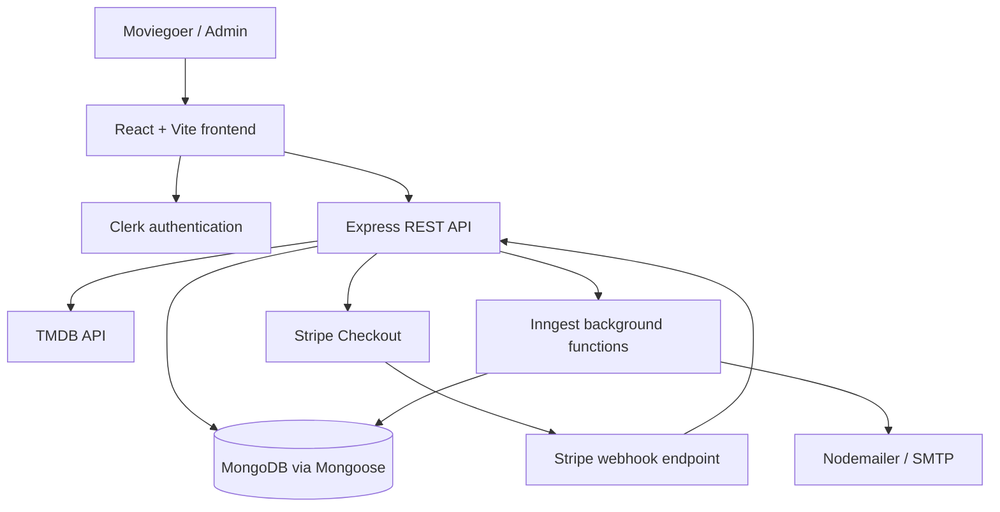
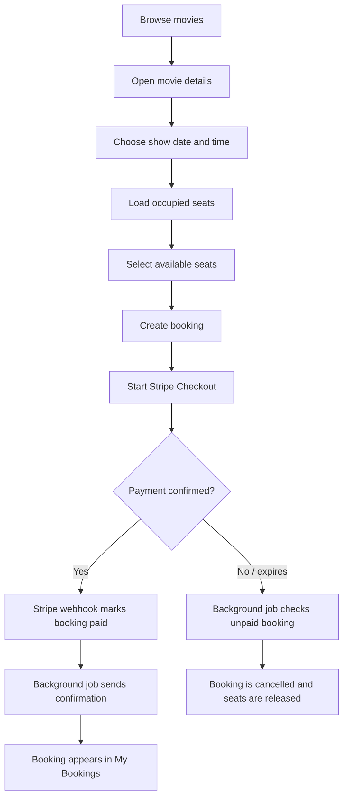

# QuickShow — Movie Ticket Booking Platform

QuickShow is a full-stack movie discovery and ticket-booking web application. Users can explore currently showing movies, view movie details and trailers, choose a show date and time, select seats, and pay online. The admin dashboard provides tools for scheduling shows and viewing booking and revenue information.

**Live application:** https://quickshow-mocha-seven.vercel.app/  
**Admin dashboard:** https://quickshow-mocha-seven.vercel.app/admin  
**Source code:** https://github.com/archita2505/QuickShow

> The live app and admin dashboard require the relevant services and credentials to be configured. Do not publish real environment-variable values in this README.

## Table of contents

- [Features](#features)
- [Screenshots](#screenshots)
- [Technology stack](#technology-stack)
- [Architecture](#architecture)
- [Booking workflow](#booking-workflow)
- [Project structure](#project-structure)
- [Getting started](#getting-started)
- [Environment variables](#environment-variables)
- [External services and setup](#external-services-and-setup)
- [API overview](#api-overview)
- [Security notes](#security-notes)
- [Possible improvements](#possible-improvements)

## Features

### Moviegoer experience
- Browse movies that are currently showing.
- Explore new releases and movie details, including artwork, ratings, runtime, and cast information where available.
- Search the available movie listings by title.
- Watch movie trailers where provided by the interface.
- Choose a show date and time and view the seat layout.
- Select up to four seats for a booking; seats already marked as occupied are shown as unavailable.
- Sign in and manage a personal account through Clerk.
- Add and remove movies from a favourites list.
- View personal bookings, ticket/seat details, payment status, and a payment link when payment is pending.
- Pay through Stripe Checkout.
- Receive booking-related email notifications through the configured background jobs and email service.

### Admin experience
- View dashboard summaries for bookings, revenue, active shows, and registered users.
- Add a movie show by selecting a movie, choosing one or more show dates/times, and setting the ticket price.
- Review upcoming shows, booking counts, and estimated earnings.
- Review booking records, including customer, movie, show time, seats, and amount.
- Admin API endpoints check the signed-in user's Clerk private metadata role before returning protected management data.

## Screenshots

Add screenshots of the **real running application** to `docs/images/` and update the paths below. Avoid screenshots containing personal information, real customer details, payment information, or secret keys.

| Page | Suggested file |
|---|---|
| Home page / hero section | `docs/images/homepage.png` |
| Movie listings or search | `docs/images/movies.png` |
| Movie details and show-date selection | `docs/images/movie-details.png` |
| Seat selection and available timings | `docs/images/seat-selection.png` |
| My Bookings | `docs/images/my-bookings.png` |
| Admin dashboard | `docs/images/admin-dashboard.png` |
| Add Shows | `docs/images/admin-add-shows.png` |
| List Shows / List Bookings | `docs/images/admin-bookings.png` |

Example Markdown once the screenshot files exist:

```md


```

## Technology stack

| Area | Technology |
|---|---|
| Frontend | React, Vite |
| Styling | Tailwind CSS |
| Routing | React Router |
| Icons and notifications | Lucide React, React Hot Toast |
| Authentication | Clerk |
| Backend | Node.js, Express |
| Database and models | MongoDB, Mongoose |
| Movie catalogue and metadata | The Movie Database (TMDB) API |
| Payments | Stripe Checkout and Stripe webhooks |
| Background jobs and events | Inngest |
| Email | Nodemailer with an SMTP provider |
| Image delivery | TMDB image URLs; Cloudinary is included in backend dependencies |
| Deployment configuration | Vercel configuration files are included for client and server |

## Architecture



The frontend sends requests to the backend using the base URL configured in `VITE_BASE_URL`. Clerk provides authentication and identity tokens. MongoDB stores user profiles, movie metadata, shows, and bookings. TMDB supplies movie information, while Stripe handles checkout and payment events. Inngest coordinates background tasks such as syncing user records, releasing seats for unpaid bookings, and sending email notifications.

## Booking workflow



The backend checks seat availability before creating a booking and records the selected seats against the show. Stripe webhook events update payment status. Background jobs support unpaid-booking cleanup and booking-related emails. For production use, seat reservation should also be protected against simultaneous booking requests with an atomic database operation or transaction.

## Project structure

```text
QuickShow/
├── client/
│   ├── public/
│   └── src/
│       ├── assets/
│       ├── components/
│       │   └── admin/
│       ├── context/
│       ├── lib/
│       ├── pages/
│       │   └── admin/
│       ├── utils/
│       ├── App.jsx
│       └── main.jsx
│   ├── package.json
│   ├── vite.config.js
│   └── vercel.json
└── server/
    ├── configs/
    ├── controllers/
    ├── inngest/
    ├── middleware/
    ├── models/
    ├── routes/
    ├── package.json
    ├── server.js
    └── vercel.json
```

### Important backend modules

- `server.js` — configures Express middleware, MongoDB connection, webhook handling, Inngest endpoint, and API routers.
- `configs/db.js` — connects to MongoDB.
- `controllers/` — contains the application logic for movies/shows, bookings, users, admin data, and Stripe webhook events.
- `models/` — Mongoose schemas for `User`, `Movie`, `Show`, and `Booking`.
- `middleware/auth.js` — checks the user's Clerk role for protected admin API endpoints.
- `inngest/index.js` — background workflows for user synchronization, unpaid-booking cleanup, and booking/show email notifications.
- `client/src/context/AppContext.jsx` — shared frontend state and API/authentication helpers.
- `client/src/pages/` — customer-facing pages.
- `client/src/pages/admin/` — admin dashboard and show/booking management pages.

## Getting started

### Prerequisites

Install or create accounts for:

- Node.js (a current LTS version is recommended) and npm
- MongoDB, either locally or through MongoDB Atlas
- Clerk
- TMDB API access
- Stripe
- Inngest
- An SMTP email provider if email notifications are to be used

### 1. Get the project

```bash
git clone https://github.com/archita2505/QuickShow.git
cd QuickShow
```

If you downloaded the source as a ZIP, extract it and open the `QuickShow-main` folder in your terminal.

### 2. Configure the frontend

```bash
cd client
npm install
```

Create `client/.env` and add the frontend variables listed in [Environment variables](#environment-variables). Set `VITE_BASE_URL` to the URL where your backend is running; for local development this is typically `http://localhost:3000`.

Start the frontend:

```bash
npm run dev
```

Vite prints the local frontend URL in the terminal (usually `http://localhost:5173`).

### 3. Configure the backend

Open a second terminal:

```bash
cd server
npm install
```

Create `server/.env` and add the backend variables listed below. Ensure MongoDB is reachable and your Clerk, TMDB, Stripe, Inngest, and SMTP settings are valid.

Start the backend in development mode:

```bash
npm run server
```

The Express server listens on `http://localhost:3000`. You can check the root route at `http://localhost:3000/`; it should return `Server is live !` when startup succeeds.

### 4. Open the app

Visit the Vite URL printed by the frontend command. Sign in through Clerk to use features that require an account. Admin access also requires the appropriate Clerk user role metadata to be configured.

> The project does not include a safe, complete sample `.env` file. Create your own local environment files; never commit real credentials.

## Environment variables

The code references the following variables. Add the relevant ones to the appropriate environment file. Use the exact values from your own service dashboards; **never copy secret values into GitHub or this README**.

### `client/.env`

```dotenv
VITE_CLERK_PUBLISHABLE_KEY=your_clerk_publishable_key
VITE_BASE_URL=http://localhost:3000
VITE_CURRENCY=₹
VITE_TMDB_IMAGE_BASE_URL=https://image.tmdb.org/t/p/
```

Set `VITE_BASE_URL` to your deployed API URL in production. `VITE_TMDB_IMAGE_BASE_URL` should match the image-size/path format used by your frontend.

### `server/.env`

```dotenv
MONGODB_URI=your_mongodb_connection_string
CLERK_SECRET_KEY=your_clerk_secret_key
INNGEST_EVENT_KEY=your_inngest_event_key
INNGEST_SIGNING_KEY=your_inngest_signing_key
TMDB_API_KEY=your_tmdb_api_key
STRIPE_SECRET_KEY=your_stripe_secret_key
STRIPE_WEBHOOK_SECRET=your_stripe_webhook_signing_secret
SENDER_EMAIL=your_sender_email
SMTP_USER=your_smtp_username
SMTP_PASS=your_smtp_password
```

Clerk's server-side integration uses `CLERK_SECRET_KEY`. Inngest deployment may require `INNGEST_EVENT_KEY` and `INNGEST_SIGNING_KEY`; configure these in accordance with your Inngest environment and deployment instructions. Configure the Clerk webhook to send the user-created, user-updated, and user-deleted events expected by the Inngest functions. Configure Stripe to send the payment events handled by the webhook controller. Do not add any real server secret to a variable beginning with `VITE_`; frontend variables are exposed to the browser bundle.

## External services and setup

- **Clerk:** configure the publishable key in the frontend, the server-side Clerk integration, and user metadata for the admin role. The protected admin APIs expect `privateMetadata.role` to equal `admin`.
- **TMDB:** the backend uses the TMDB API to retrieve currently playing movies and movie details/credits.
- **MongoDB:** stores users, movie records, show schedules, occupied seats, and booking/payment state.
- **Stripe:** create Checkout sessions and configure a webhook endpoint at `/api/stripe` using the signing secret for that endpoint.
- **Inngest:** serve the functions through `/api/inngest` and configure the events/cron workflows used by the application.
- **SMTP:** configure valid sender and SMTP credentials for notification emails.

Provider dashboards and webhook setup steps can change over time, so use the official documentation for the account-specific configuration.

## API overview

The backend exposes these route groups:

| Method | Path | Purpose |
|---|---|---|
| `GET` | `/` | Server health check |
| `GET` | `/api/show/now-playing` | Retrieve currently playing TMDB movies |
| `GET` | `/api/show/all` | List available shows |
| `GET` | `/api/show/:movieId` | Get show/movie details |
| `POST` | `/api/show/add` | Add a show (admin-protected) |
| `POST` | `/api/booking/create` | Create a booking and begin checkout |
| `GET` | `/api/booking/seats/:showId` | Retrieve occupied seats for a show |
| `GET` | `/api/user/bookings` | Get the signed-in user's bookings |
| `POST` | `/api/user/update-favourite` | Add/remove a favourite movie |
| `GET` | `/api/user/favourites` | Get favourite movies |
| `GET` | `/api/admin/is-admin` | Admin UI status check |
| `GET` | `/api/admin/dashboard` | Dashboard totals (admin-protected) |
| `GET` | `/api/admin/all-shows` | List upcoming shows (admin-protected) |
| `GET` | `/api/admin/all-bookings` | List bookings (admin-protected) |
| `POST` | `/api/stripe` | Stripe webhook endpoint |
| `GET` / `POST` | `/api/inngest` | Inngest function endpoint |

Authenticated requests use a Clerk-issued bearer token. Request bodies and response shapes are defined in the route controllers.

## Security notes

Before making the repository public or sharing the ZIP:

1. Remove `.env` files from version control and from shared archives. Use `.env.example` files containing placeholders instead.
2. If any real key, password, token, database URI, or webhook secret was ever committed or shared, rotate it in the relevant provider dashboard. Deleting it from the latest commit alone does not invalidate it.
3. Confirm admin authorization on both frontend and backend. The backend's protected dashboard/list/add endpoints use role checks, but the current `/api/admin/is-admin` handler returns `isAdmin: true` without verifying the user's role. Fix this before production so ordinary signed-in users cannot be presented with the admin UI or treated as admins.
4. Review seat booking for race conditions: checking availability and saving occupied seats are separate operations in the current implementation. Consider an atomic update or transaction.
5. Validate request data and add appropriate rate limits, logging, and error handling before production deployment.

## Possible improvements

- Add automated tests for authentication, seat availability, booking creation, payment callbacks, and admin authorization.
- Make seat reservation atomic to prevent two customers from booking the same seat concurrently.
- Add robust API input validation and consistent HTTP status codes.
- Add pagination and filtering for admin booking/show tables.
- Improve loading, empty, and error states across pages.
- Add accessibility checks and end-to-end tests for the complete booking journey.
- Add `client/.env.example` and `server/.env.example` with placeholder values only.
- Add genuine screenshots and a short demo GIF/video to this README.

---

Made for movie discovery and online ticket booking. If you extend this project, keep secrets out of source control and document any new environment variables or setup steps.

